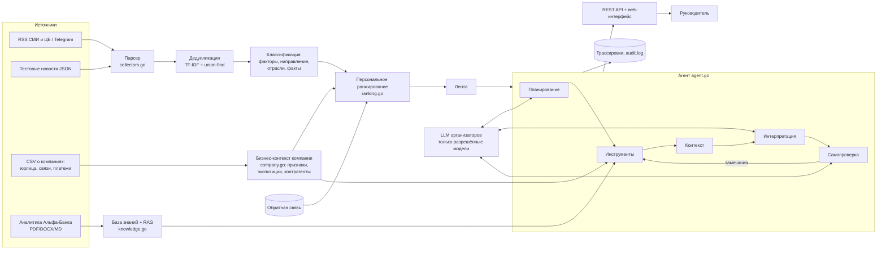

# alfa-insight — новостная аналитика для принятия бизнес-решений

Прототип для трека «Превратить поток новостей в бизнес-решения». Сервис для руководителей крупного бизнеса (выручка
свыше 15 млрд ₽): он берёт внешние новости и аналитику Альфа-Банка, **определяет бизнес-контекст конкретной компании**,
отбирает значимые для неё события и объясняет их влияние: что произошло, почему это важно именно этой компании, какие
риски и возможности появляются, что можно сделать, как событие оценивает банк и на чём основан каждый вывод.

Сервис не пересказывает новости. Каждый вывод связан с признаками клиента (продукты банка, отрасль по ОКВЭД, ВЭД,
контрагенты по платежам, регион), с первоисточником новости и с фрагментом аналитики банка.

- Язык: **Go 1.24, только стандартная библиотека** (внешних зависимостей нет, сборка воспроизводима).
- Работает **без LLM** (детерминированный агент), а **с ключом организаторов** переключается на разрешённые LLM.
- Веб-интерфейс имитирует главный экран интернет-банка с постоянной точкой входа «Новостная аналитика».
- REST API описан в `docs/openapi.yaml`.

---

## Быстрый старт

### Без API-ключа (офлайн-режим)

```bash
# нужен Go 1.24+  (https://go.dev/dl/)
go build -o alfa-insight .
./alfa-insight serve            # открыть http://localhost:8080
```

На Windows: `go build -o alfa-insight.exe .`, затем `alfa-insight.exe serve`.

### С API-ключом организаторов

1. Скопируйте шаблон настроек (если файла `.env` ещё нет): `cp .env.example .env`.
2. Впишите в `.env` адрес API и ключ:
   ```env
   LLM_BASE_URL=https://<адрес-от-организаторов>/v1
   LLM_API_KEY=sk-...
   ```
   Адрес указывается **без** `/chat/completions`. Обычно он заканчивается на `/v1`.
3. Узнайте точные названия моделей:
   ```bash
   go build -o alfa-insight .
   ./alfa-insight llm-models     # все модели по ключу; разрешённые кейсом отмечены ✓
   ```
   Если названия отличаются от значений по умолчанию, пропишите их в `.env` точно так, как их вывела команда
   (`LLM_MODEL_FAST`, `_REASONING`, `_GENERAL`, `_RESEARCH`, `_TEXT`, `_VISION`).
4. Проверьте, что модели отвечают (по одному короткому запросу к каждой): `./alfa-insight llm-check`.
5. Запустите сервис: `./alfa-insight serve`. В карточке события появится «подготовлено языковой моделью» и названия моделей,
   в «Ходе рассуждений агента» — шаги `llm_plan`, `write_insight`, `llm_critic`.

> ⚠️ `.env` с ключом добавлен в `.gitignore`. **Не коммитьте ключ в репозиторий**: жюри получит доступ к коду.
> Если ключ всё-таки попал в историю git, попросите у организаторов новый.

### Какая модель для чего

Один ключ даёт доступ ко всем шести разрешённым моделям (Приложение 3 / слайд 18), и модель выбирается в **каждом запросе**
под задачу. Если основная модель недоступна, запрос автоматически уходит в резервную; это видно в трассировке.

| Задача | Основная модель | Резерв | Почему |
|---|---|---|---|
| План агента | Gemma 4 26B A4B | Qwen3.6 | Простая задача: выбрать инструменты, вернуть JSON |
| Интерпретация события | GLM-5.3-Flash | Kimi-K2.6 → Qwen3.6 | Глубокий анализ и рассуждения по нескольким факторам |
| Самопроверка (критик) | DeepSeek-V4.1-Flash | Gemma 4 | Сверка вывода с источниками; **другая модель, чем писатель** — вывод не проверяет сам себя. Kimi-K2.6 на шлюзе организаторов рассуждает даже с отключённым thinking (~5 ₽ за проверку против ~0,1 ₽ у DeepSeek) |
| Ответы на уточняющие вопросы | Qwen3.6 35B A3B | GLM-5.3-Flash | Универсальная модель |
| Вопросы о взаимосвязях и трендах по всей ленте | DeepSeek-V4.1-Flash | Qwen3.6 | Поиск взаимосвязей, большие объёмы |
| Графики и сканы в PDF-материалах банка | Qwen3-VL-30B-A3B-Instruct | — | Мультимодальная модель; включается `ANALYTICS_VISION_OCR=true` |

Маршрутизация задана в `llm.go` (`taskChains`) и видна на экране «Качество и мониторинг» и в `GET /api/metrics`.

### Бюджет: 500 ₽ в день на всю команду

Лимит **общий для всех моделей и всех участников**, поэтому сервис экономит токены:

- **Кэш** (`LLM_CACHE=true`): одинаковый запрос второй раз не оплачивается. Инсайт для пары «компания + событие + роль»
  после генерации хранится в памяти.
- **Дешёвые модели для простых шагов**: план строит Gemma, дорогую модель вызывает только писатель.
- **Лимиты на экземпляр сервиса**: `LLM_DAILY_TOKEN_LIMIT`, а также `LLM_DAILY_BUDGET_RUB`, если заданы цены
  `LLM_PRICE_*` (₽ за 1 млн токенов, «вход,выход»). Счётчик видит только свой экземпляр, поэтому договоритесь
  о долях: например, 150 ₽ на демо-сервер, остальное — участникам для разработки.
- **Массовые прогоны бесплатны по умолчанию**: `./alfa-insight eval` работает офлайн, LLM включается только флагом `--llm`.
- **Тесты** (`go test`) не ходят в настоящий API: они используют mock-сервер.
- При исчерпании лимита или ошибке API агент **автоматически переходит в офлайн-режим**, и сервис продолжает работать.

Ориентир: один инсайт — 3–4 запроса (план ≈ 0,5 тыс. токенов, интерпретация ≈ 4–6 тыс., критик ≈ 2–3 тыс.).
Расход по моделям виден на экране «Качество и мониторинг».

### Docker

```bash
cp .env.example .env     # и заполните LLM_BASE_URL / LLM_API_KEY (или оставьте пустыми для офлайн-режима)
docker compose up --build
# http://localhost:8080
```

Каталоги `data/company`, `data/alfa_analytics`, `output`, `data/state` подключаются как тома: данные можно обновлять
без пересборки образа.

### Данные

Всё нужное для запуска уже в репозитории:

| Что | Где | Объём |
|---|---|---|
| Данные о компаниях из кейса: юрлица, связанные физлица, платежи | `data/company/` | 85,5 тыс. компаний, 12,5 тыс. связей, 1,38 млн платежей |
| Аналитические материалы Альфа-Банка из кейса (расшифровки страниц) | `data/alfa_analytics/_text/` | 9 материалов, июль–сентябрь 2026 и отчёт 2021 г. |
| Лента новостей для демонстрации | `data/news/sample_news.json` | 26 публикаций (источники помечены «Демо») |
| Отложенный набор новостей для проверки устойчивости | `data/news/holdout_news.json` | 8 публикаций, не использовались при разработке |

Загрузка данных о компаниях занимает 4–5 секунд при старте; профиль компании строится по запросу и кэшируется.

**Материалы банка.** PDF-материалы кейса — сканы без текстового слоя, поэтому сервис работает с расшифровками страниц
(`data/alfa_analytics/_text/*.md`, у каждой страницы метка номера, у документа — дата и имя PDF). Каждый фрагмент знает файл
и страницу, и цитата банка в интерфейсе подписана «…, стр. 2». Если положить сами PDF в `data/alfa_analytics/`, сервис
сопоставит их с расшифровками; новые сканы без расшифровки распознаёт Qwen3-VL (`ANALYTICS_VISION_OCR=true`).
`./alfa-insight analytics` печатает материалы, их актуальность и извлечённые прогнозы банка.

**Новости.** По умолчанию лента — демонстрационный набор (`NEWS_MODE=reference`), чтобы сценарий проверки был
воспроизводимым. Реальные новости из RSS (ЦБ, Интерфакс, РБК, Коммерсантъ, Ведомости, ПРАЙМ, Лента.ру):
`NEWS_MODE=live` или `POST /api/refresh?mode=live`; список источников — `configs/sources.json`.

---

## Сценарий проверки (end-to-end)

Демонстрационные компании из данных кейса:

| ID | Кто это | Что показывает |
|---|---|---|
| `U_20244` | оптовая торговля зерном, 23 млрд ₽, Новосибирская обл.; кредиты, депозиты, лизинг, ВЭД (Индия, Китай, Италия) | ставка: риск по кредитам и возможность по депозитам; пошлины и урожай; калькулятор |
| `U_57706` | крупнейшая компания базы: оптовая торговля топливом, 105,6 млрд ₽; депозиты, лизинг, ВЭД | нефть и логистика выходят наверх ленты |
| `U_1595` | розничная торговля одеждой, 16,5 млрд ₽; кредиты, лизинг, импорт из Турции | потребительский спрос, рост ВВП, издержки |
| `U_339170` | холдинговая компания без платежей и связей | работа с неполными данными |

1. `./alfa-insight serve` → открыть http://localhost:8080.
2. **Главный экран**: карточка «Новостная аналитика: N событий важны для вашей компании» — точка входа.
   Она также постоянно доступна в левом меню (с бейджем).
3. В шапке выбрать компанию `U_20244` и роль «Финансовый директор». Любую из 85 тыс. компаний можно открыть по ID
   в поле поиска рядом со списком.
4. «Открыть аналитику» → лента отсортирована по релевантности: для зернотрейдера наверху удобрения, экспортная пошлина
   на пшеницу, инфляция. У каждого события — метка «Риск/Возможность» и причина показа.
5. Сменить компанию на `U_57706` (топливо) → наверху нефть и фрахт; на `U_1595` (одежда) → потребительский спрос и ВВП.
   Смена роли (например, «Генеральный директор») меняет порядок событий.
6. Вернуть `U_20244` и открыть событие «Банк России сохранил ключевую ставку…». Ответы на 6 вопросов:
   факты с источниками; почему это важно компании (кредиты и лизинг — риск, депозиты — возможность); риски и
   возможности; действия, вопросы и сценарии; **позиция Альфа-Банка** (синий блок: актуальный прогноз 14,0% на конец 2026 г.,
   история пересмотров 13,5% → 14,0%, цитаты со страницами) отдельно от **выводов AI** (фиолетовые метки);
   калькулятор «что если» в рублях; список источников. Подписи источников кликабельны.
7. «Ход рассуждений агента» показывает план, вызовы инструментов, самопроверку и, в LLM-режиме, вызовы моделей.
8. Задать вопрос «Что думает банк о курсе рубля?» или выбрать фактор в фильтре ленты (другой разрез данных).
9. Нажать 👍/👎 → лента пересчитывается с учётом обратной связи.
10. «Профиль компании» показывает, как сервис видит клиента: признаки, специализацию по ОКВЭД, чувствительность к факторам,
    контрагентов, калькулятор. `U_339170` — пример неполных данных.
11. «Материалы банка»: прогнозы банка и история их пересмотров, заседания из материалов, актуальность каждого
    материала (отчёт по стали 2021 г. помечен устаревшим).
12. «Качество и мониторинг»: режим работы, доля прошедших самопроверку, обратная связь, расход токенов.
13. Проверка устойчивости на новостях, которых не было при разработке: `./alfa-insight eval`
    (или `POST /api/refresh?mode=holdout` и повторить сценарий). Реальные новости: `POST /api/refresh?mode=live`.

Консоль: `./alfa-insight demo`, `./alfa-insight feed --company U_57706 --role cfo`,
`./alfa-insight insight --company U_20244 --role cfo --trace`, `./alfa-insight ask --company U_20244 --question "Что думает банк о курсе рубля?"`.

---

## Чем решение отличается

1. **Актуальная позиция банка, а не случайная цитата.** Материалы банка выходят в разные даты, и прогнозы в них
   пересматриваются. Сервис кодом извлекает числовые прогнозы (ставка, инфляция, курс, ВВП на конец года) из всех материалов
   с датой и ссылкой на фрагмент, считает текущим прогноз из самого свежего материала и показывает историю пересмотров.
   Если RAG нашёл фрагмент с уже пересмотренным прогнозом, в инсайте появляется предупреждение, а самопроверка
   (`freshness`) не пропустит такую цитату без пометки. Материалы старше полугода ранжируются ниже и помечаются.
   Если в свежих материалах нет позиции по теме, сервис так и пишет, а не подставляет нерелевантную цитату.
2. **Влияние в рублях.** Калькулятор переводит прогноз банка в эффект на прибыль компании за год
   (формулы видны пользователю, каждое число помечено: данные клиента / аналитика банка / допущение).
3. **Каналы влияния.** Один фактор действует на компанию по-разному: ставка повышает стоимость кредитов (риск),
   но и доходность депозитов (возможность), а через контрагентов меняет их спрос и платёжную дисциплину.
   Каждый канал — отдельный пункт с полем данных-источником.
4. **Календарь.** Даты будущих заседаний ЦБ и ФРС берутся из материалов банка и попадают в «За чем следить».

---

## Архитектура



### Модули

| Файл | Что делает |
|---|---|
| `company.go` | Чтение CSV (автоопределение разделителя и BOM, потоковое чтение). Строит бизнес-контекст: отрасль по ОКВЭД, масштаб, продукты банка, ВЭД, группа, связи через физлиц, топ-контрагенты и их отрасли. **Экспозиции** описывают, какой фактор, в какую сторону и почему влияет на компанию; у каждой указано поле-источник. |
| `taxonomy.go` | 18 макро- и отраслевых факторов (ставка, курс, инфляция, нефть, металлы, налоги, логистика…) и 24 отрасли по разделам ОКВЭД с чувствительностью к факторам. |
| `collectors.go` | Парсер RSS/Atom (включая windows-1251), публичных Telegram-каналов и автопоиск RSS на странице. Источники опрашиваются параллельно. |
| `dedup.go` | Склейка публикаций об одном событии: точное совпадение, семантическая близость, общие слова и близость по времени. |
| `classify.go` | Факторы события и направление их изменения («ставка сохранена», «рубль укрепился», «юань подорожал» → рубль ослаб), отрасли, регионы, участники, ключевые факты, признаки prompt-injection. |
| `knowledge.go` | Загрузка материалов банка (PDF → текстовый слой, расшифровка из `_text/` или Qwen3-VL), нарезка по страницам, актуальность; гибридный RAG-поиск (семантика + факторы/отрасли + свежесть). |
| `forecasts.go` | Извлечение числовых прогнозов банка, история пересмотров, предупреждения об устаревших цитатах, календарь заседаний. |
| `scenario.go` | Калькулятор «что если»: ставка и курс в рублях для компании. |
| `morph.go` | Лёгкая морфология: поиск терминов с учётом окончаний («о курсе рубля» ↔ «курс рубл»), основы слов для TF-IDF. |
| `ranking.go` | Персональное ранжирование с причинами показа; обратная связь (like/dislike). |
| `agent.go` | Агент: план → инструменты → контекст → интерпретация → самопроверка и адаптация; трассировка; ответы на вопросы. |
| `insight.go` | JSON-схема инсайта, офлайн-составитель текста, проверки самопроверки. |
| `llm.go` | OpenAI-совместимый клиент: список разрешённых моделей, выбор модели под задачу в каждом запросе, резервные модели, кэш, учёт токенов и рублей, Qwen3-VL для изображений. |
| `security.go` | Права ролей на инструменты, маскирование ПДн, защита от prompt-injection, аудит, бюджет. |
| `server.go`, `web/index.html` | REST API и интерфейс (без внешних JS/CSS-библиотек). |
| `eval.go` | Проверка на отложенных новостях и консольная демонстрация. |

### Агентная логика (требования кейса)

| Требование | Реализация |
|---|---|
| **Планирование** | В LLM-режиме Gemma составляет план из доступных роли инструментов. Валидатор добавляет обязательные шаги и упорядочивает план. Без LLM план строится детерминированно и зависит от события: например, `get_counterparties` вызывается, только если отрасли события пересекаются с отраслями контрагентов, а событие связано с ВЭД или логистикой. |
| **Инструменты** | `get_company_profile`, `get_event`, `match_exposure`, `search_alfa_analytics` (RAG), `get_bank_forecasts` (актуальные прогнозы банка и их пересмотры, календарь), `search_news`, `get_counterparties`, `get_feedback_summary`. Все инструменты только читают данные. |
| **Контекст** | `AgentContext` накапливает результаты шагов (профиль, сопоставления, найденная аналитика, связанные новости, контрагенты). Итоговый вывод строится только из него. |
| **Самопроверка и адаптация** | Кодовые проверки: полнота (все 6 вопросов), обоснованность (у каждого пункта есть существующий источник), цифры (каждое число в фактах и позиции банка есть в первоисточнике), непротиворечивость, разделение «банк / AI», актуальность позиции банка (нет устаревших и пересмотренных цитат без пометки), безопасность. В LLM-режиме добавляется модель-критик (DeepSeek-V4.1-Flash — другая модель, чем писатель GLM). При замечаниях агент повторяет поиск аналитики с другим запросом, просит модель переписать вывод с учётом замечаний, удаляет необоснованные пункты. Делает до 3 итераций. Модель также может сама запросить дополнительный инструмент (`need_more`). |
| **Трассируемость** | Каждый шаг (вход, выход, длительность, токены) пишется в трассировку: `output/traces/*.json`, `GET /api/trace/{id}` и в интерфейсе. Каждый пункт инсайта ссылается на источники: `N*` — новость, `A*` — фрагмент аналитики банка, `C:<ПОЛЕ>` — поле данных клиента, `R:*` — связанная новость. |

### Формат обмена (JSON)

Инсайт — структурированный JSON (схема в `docs/openapi.yaml` → `Insight`). В нём подтверждённые факты
(`status: confirmed | reported | assumption`) отделены от позиции банка (`bank_view`, только из источников `A*`)
и от выводов модели (`model_conclusions`, `origin: model`). Реестр источников, признаки клиента и цитаты банка
формирует **код, а не LLM**: модель не может «придумать» источник, а ссылки на несуществующие ID удаляются самопроверкой.

### Ранжирование

```
score = 0.38·экспозиция + 0.17·отрасль + 0.10·семантика + 0.05·регион
      + 0.10·свежесть + 0.06·надёжность источника + 0.06·есть аналитика банка + 0.15·обратная связь
```

- **Экспозиция** — вес фактора для компании с учётом роли пользователя. Например, у финансового директора усилены ставка и курс,
  у главного бухгалтера — налоги и регулирование.
- **Отрасль** — новость о собственной отрасли компании или об отрасли её контрагентов (с учётом доли в обороте).
- Новости без связи с бизнесом штрафуются и не показываются (порог `min_score`).

Веса задаются в `configs/ranking.json` и меняются без изменения кода.

### Безопасность AI-компонентов

| Механизм | Где |
|---|---|
| Разграничение прав: у роли свой список инструментов (например, платежи контрагентов недоступны рядовому сотруднику) | `security.go: roleTools`, отказы пишутся в трассировку и аудит |
| Нет потенциально опасных действий: все инструменты только читают; агент не может инициировать платежи или изменения | `agent.go: tools` |
| Защита чувствительных данных: в LLM уходят производные признаки, а не сырые платежи; маскируются e-mail, телефоны, ИНН, номера карт и счетов | `security.go: maskPII` |
| Prompt-injection: новости и материалы передаются в тегах `<data>` как данные; подозрительные фразы вырезаются; новость с инъекцией понижается и помечается | `security.go`, `ranking.go` |
| Только разрешённые модели: вызов модели вне списка кейса блокируется | `llm.go: modelAllowed` |
| Журналирование: все вызовы инструментов, LLM, API и отказы пишутся в `output/audit.log` (JSONL) | `security.go: audit` |
| Бюджет: дневной лимит токенов, кэш, переход в офлайн-режим | `security.go`, `llm.go` |
| Ограничение размера запросов к API, заголовки безопасности, Docker-контейнер без root | `server.go`, `Dockerfile` |

В продакшене добавляются SSO интернет-банка (вместо демо-выбора компании), проверка, что пользователь привязан к компании,
и хранение секретов в Vault.

### Метрики и мониторинг качества

- **Автоматические** (`/api/metrics`, экран «Качество»): доля инсайтов, прошедших самопроверку, доля инсайтов с позицией банка,
  средняя уверенность, число доработок после самопроверки, переходы в офлайн-режим, расход токенов по моделям.
- **Персонализация** (`./alfa-insight eval`): насколько различаются топ-3 ленты разных компаний; доля отфильтрованного шума;
  доля инсайтов с актуальным прогнозом банка и с калькулятором; число цитат устаревших материалов без пометки (должно быть 0);
  распознавание факторов на перефразированных формулировках (это регрессионный набор, а не независимая проверка).
- **Пользовательские**: like/dislike по событию (влияет на ранжирование), агрегаты по всем пользователям.
- **Экспертные**: трассировки и `output/insights/*.json` позволяют аналитикам банка выборочно оценивать инсайты
  (точность фактов, полезность действий, корректность позиции банка). Предлагаемый регламент — еженедельная выборка
  из 30 инсайтов с оценкой по шкале 1–5 по каждому из 6 вопросов. Правила (`taxonomy.go`) и веса (`configs/ranking.json`)
  корректируются по итогам.

### Масштабирование и сопровождение

- **Новые отрасли и факторы** — добавить запись в `taxonomy.go` (ключевые слова, чувствительность). Код агента не меняется.
- **Новые источники новостей** — строка в `configs/sources.json` (RSS / Telegram / автопоиск RSS).
- **Новые материалы банка** — положить файл в `data/alfa_analytics/`, индекс пересоберётся при запуске.
- **Новые типы клиентов** — признаки строятся из полей CSV. Порог «крупный бизнес» (15 млрд ₽) задан константой,
  но сервис работает и для компаний ниже порога.
- **Нагрузка**: профили компаний и инсайты кэшируются. Для продакшена — вынести хранилища (обратная связь, кэш, трассировки)
  в PostgreSQL/Redis, эмбеддинги — в векторную БД, сбор новостей — в отдельный воркер по расписанию.
  Сервис stateless (кроме `data/state`) и масштабируется горизонтально.

---

## Переменные окружения

| Переменная | По умолчанию | Описание |
|---|---|---|
| `LLM_BASE_URL` | — | Адрес OpenAI-совместимого API организаторов (`.../v1`) |
| `LLM_API_KEY` | — | Ключ команды |
| `LLM_MODEL_FAST` | `gemma-4-26b-a4b` | План агента |
| `LLM_MODEL_REASONING` | `glm-5.3-flash` | Интерпретация события |
| `LLM_MODEL_GENERAL` | `qwen3.6-35b-a3b` | Ответы на вопросы, резерв |
| `LLM_MODEL_RESEARCH` | `deepseek-v4.1-flash` | Вопросы о взаимосвязях |
| `LLM_MODEL_TEXT` | `kimi-k2.6` | Критик, резерв писателя |
| `LLM_MODEL_VISION` | `qwen3-vl-30b-a3b-instruct` | Графики/сканы в PDF |
| `LLM_DAILY_BUDGET_RUB` | `150` | Доля общего бюджета 500 ₽ на этот экземпляр (работает, если заданы цены) |
| `LLM_PRICE_FAST` … `LLM_PRICE_VISION` | — | Цена ₽ за 1 млн токенов «вход,выход» |
| `ANALYTICS_VISION_OCR` | `false` | Расшифровывать страницы PDF без текста моделью Qwen3-VL |
| `ANALYTICS_STALE_DAYS` | `180` | Материал банка старше этого срока считается устаревшим |
| `ANALYTICS_NOW` | текущая дата | «Сегодня» для оценки актуальности (для воспроизводимого демо) |
| `LLM_ALLOWED_MODELS` | список кейса | Фрагменты имён разрешённых моделей через запятую |
| `LLM_DAILY_TOKEN_LIMIT` | `400000` | Дневной лимит токенов |
| `LLM_CACHE` | `true` | Кэш ответов LLM на диске |
| `LLM_THINKING` | `false` | Рассуждения (thinking) у GLM, Kimi, Qwen3.6, DeepSeek; выключены, чтобы экономить бюджет и не обрезать ответ |
| `LLM_MODE` | `auto` | `offline` — принудительно без LLM |
| `LLM_MAX_AGENT_STEPS` | `6` | Максимум шагов плана |
| `EMBEDDING_PROVIDER` | `tfidf` | `bge` — BGE-M3 через Ollama (допустимость уточните у организаторов) |
| `NEWS_MODE` | `reference` | `reference` / `live` / `file` / `holdout` |
| `NEWS_FILE` | — | JSON с новостями для `file` |
| `NEWS_HOURS` | `72` | Окно live-сбора |
| `COMPANY_DATA_DIR` | `data/company` | Каталог с CSV о компаниях |
| `ALFA_ANALYTICS_DIR` | `data/alfa_analytics` | Каталог с материалами банка |
| `ADDR` | `:8080` | Адрес сервера |

## Требования к окружению

- Go 1.24+ (зафиксировано в `go.mod`: `toolchain go1.24.7`) **или** Docker с Compose v2.
- Для PDF-материалов вне Docker — `pdftotext` и `pdftoppm` (Ubuntu: `apt install poppler-utils`, macOS: `brew install poppler`).
- Сеть нужна только для LLM API и режима `live`.

## Тесты

```bash
go test ./...
```

Тесты не требуют сети и ключа и не тратят бюджет. LLM-ветка агента проверяется на локальном mock-сервере
OpenAI-совместимого API: план, инструменты, черновик с намеренной ошибкой и её удаление самопроверкой, выбор модели под задачу,
переход на резервную модель при сбое GLM, Qwen3-VL для изображений, рублёвый лимит.

## Структура проекта

```
├── main.go            CLI: serve, companies, profile, feed, insight, ask, analytics, eval [--llm], demo, llm-models, llm-check
├── agent.go           агент: план, инструменты, контекст, самопроверка, трассировка, вопросы
├── insight.go         схема инсайта, офлайн-составитель, проверки
├── company.go         данные о компаниях → бизнес-контекст
├── taxonomy.go        факторы и отрасли (ОКВЭД)
├── classify.go        разметка новостей
├── collectors.go      парсер RSS / Telegram
├── dedup.go           дедупликация
├── knowledge.go       аналитика банка + RAG
├── forecasts.go       прогнозы банка, пересмотры, календарь
├── scenario.go        калькулятор «что если»
├── morph.go           морфология для поиска терминов
├── ranking.go         персональное ранжирование + обратная связь
├── llm.go             клиент LLM
├── security.go        права, ПДн, инъекции, аудит, бюджет
├── server.go          REST API
├── embeddings.go      TF-IDF / BGE-M3
├── eval.go            оценка качества и демо
├── util.go, news.go, news_models.go, roles.go, config.go
├── core_test.go       тесты
├── realdata_test.go   тесты на реальных материалах банка
├── web/index.html     интерфейс
├── configs/           ranking.json, sources.json
├── data/              company/ (CSV кейса), alfa_analytics/ (материалы банка), news/ (лента), state/
├── docs/openapi.yaml  описание API
├── Dockerfile, docker-compose.yml, Makefile, .env.example
└── THIRD_PARTY_NOTICES.md
```

## Ограничения прототипа

- Разметка новостей в офлайн-режиме основана на правилах (ключевые слова и стемы). В LLM-режиме интерпретацию пишет модель,
  но базовая разметка остаётся детерминированной, поэтому она воспроизводима и проверяема.
- Лента по умолчанию — демонстрационный набор новостей (источники помечены «Демо»); реальные новости — режим `live`.
  Материалы банка — расшифровки сканов кейса; числа, снятые с графиков, приблизительные и помечены «по графикам».
- Специализация компании уточняется по 4–5 знакам ОКВЭД только для частых в данных кейса видов деятельности
  (оптовая торговля топливом, металлами, зерном, продуктами, химией, стройматериалами, электроникой и др.).
- Прогнозы банка извлекаются правилами для 5 показателей (ставка, инфляция, курс доллара и юаня, ВВП); прогнозы по
  отраслям и компаниям остаются в тексте и доступны через RAG.
- В калькуляторе размер долга и валютная доля — допущения (их нет в данных кейса), пользователь их уточняет.
- Авторизация и интернет-банк смоделированы (см. `THIRD_PARTY_NOTICES.md`).
